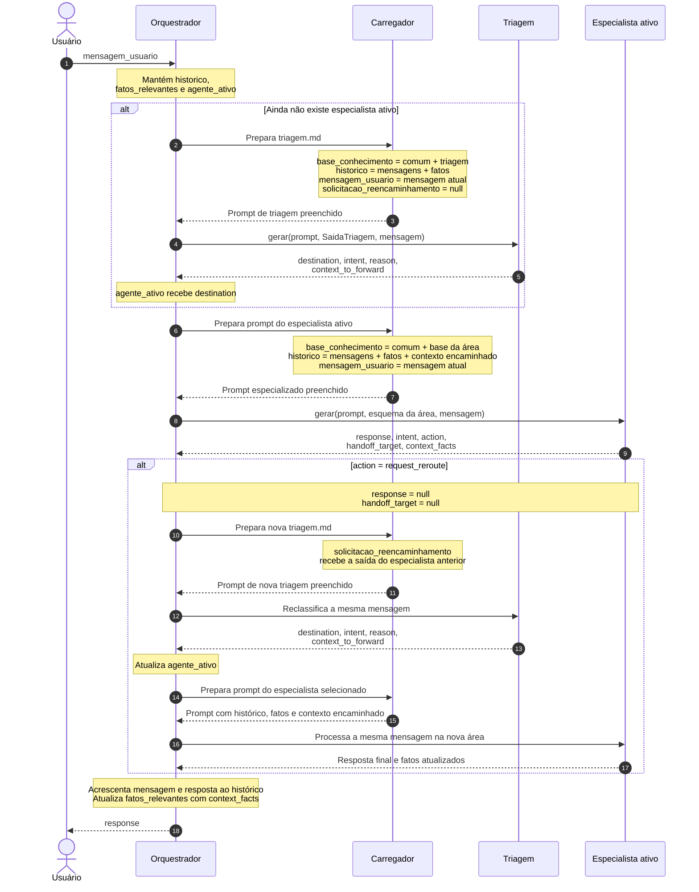

***Nota***: Neste diagrama, “Especialista ativo” representa primeiro atendimento, comercial, ouvidoria ou suporte. Após a nova triagem, esse participante representa o especialista selecionado. Uma segunda solicitação de nova triagem na mesma mensagem é tratada como erro pelo código.

As variáveis usadas no preenchimento são:

| Variável do prompt | Conteúdo fornecido |
|---|---|
| `{{base_conhecimento}}` | Base reunida conforme o agente chamado |
| `{{historico}}` | Lista JSON de mensagens e fatos; fatos usam `role="context"` |
| `{{mensagem_usuario}}` | Mensagem atual |
| `{{solicitacao_reencaminhamento}}` | Saída do especialista que pediu nova triagem; `null` na triagem inicial |

`context_to_forward` retorna da triagem para o orquestrador e entra no contexto do próximo especialista. `context_facts` retorna do agente responsável e atualiza os fatos da conversa. O histórico completo permanece armazenado separadamente.